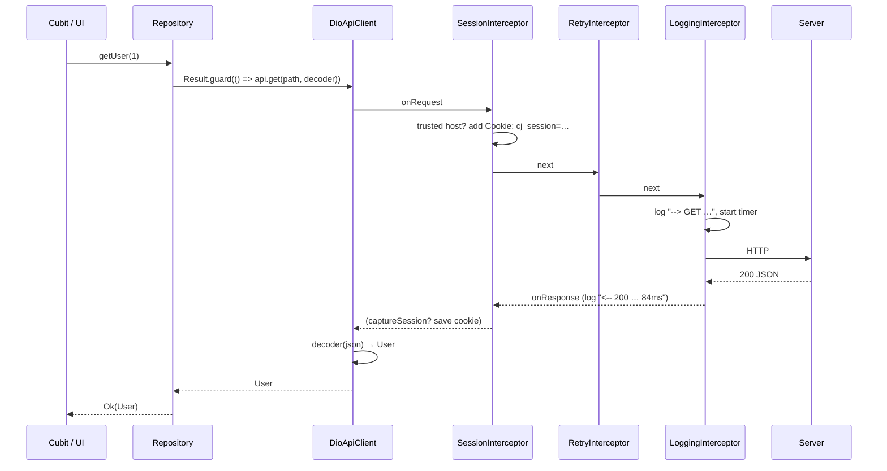

# Networking & Error Handling

How an API call travels through the app, and how every failure is handled.

## 1. Folder structure

```
lib/
├── bootstrap.dart                      # Global error handlers + DI + runApp
├── app/
│   ├── config/                         # Environment, FlavorConfig, AppConfig (baseUrl, logging)
│   └── di/injection.dart               # Registers storage, Dio, SessionManager, ApiClient
└── core/
    ├── constants/api_constants.dart    # Timeouts, headers, cookie name, retry limits
    ├── network/
    │   ├── api_client.dart             # ApiClient interface (what features depend on)
    │   ├── dio_api_client.dart         # Dio implementation: request → decode → Failure
    │   ├── dio_factory.dart            # Builds the main Dio and the refresh Dio
    │   ├── api_endpoints.dart          # Endpoint paths
    │   ├── session_manager.dart        # Stores session, shares one refresh across 401s
    │   ├── session_cookie_parser.dart  # Reads cj_session from Set-Cookie
    │   ├── session_signals.dart        # Internal markers: session expired / recovery failed
    │   └── interceptors/
    │       ├── session_interceptor.dart   # Adds cookie, captures login cookie, 401 refresh + replay
    │       ├── retry_interceptor.dart     # Backoff retry for GET/HEAD/OPTIONS
    │       └── logging_interceptor.dart   # Timing + redacted logs
    ├── error/
    │   ├── failure.dart                # Sealed Failure types (what the UI sees)
    │   ├── error_mapper.dart           # ANY error → Failure (single place)
    │   ├── api_error_body.dart         # Parses {message, errors} from error responses
    │   └── error_reporter.dart         # Sink for unexpected errors (plug Crashlytics here)
    ├── result/result.dart              # Result<T> = Ok | Err, plus Result.guard
    ├── storage/session_storage.dart    # Secure storage for the session id
    └── widgets/app_error_view.dart     # Renders a Failure with optional retry
```

## 2. Startup: how Dio gets built

1. `main_<flavor>.dart` calls `bootstrap(Environment.x)`.
2. `bootstrap` installs global error handlers (see §6), then `AppConfig.initialize(...)` picks the base URL and logging flag for the flavor.
3. `configureDependencies()` registers lazily:
   - `FlutterSecureStorage` → `SessionStorageInterface`
   - **refresh Dio** — base options + logging only (no session interceptor, so a refresh can never trigger another refresh)
   - `SessionManager` (uses the refresh Dio)
   - **main Dio** — base options + interceptors in this order:
     1. `SessionInterceptor`
     2. `RetryInterceptor`
     3. `LoggingInterceptor` (only if the flavor enables logging)
   - `ApiClient` → `DioApiClient(mainDio)`

Base options for both clients: `baseUrl`, 30s connect/send/receive timeouts, JSON `Accept`/`Content-Type`.

## 3. A request, step by step



**Request phase** (`onRequest`, in order):

| Step | Where | What happens |
|---|---|---|
| 1 | `Result.guard` | Wraps the whole call; nothing thrown can escape it. |
| 2 | `DioApiClient.request` | Calls `dio.request` with the method, data, query, options, cancel token, progress callbacks. |
| 3 | `SessionInterceptor` | Rejects any URL not on the configured base host. Adds `Cookie: cj_session=<id>` unless `extra[skipAuth]`. Stamps the current auth *generation*. |
| 4 | `RetryInterceptor` | Nothing on the way out. |
| 5 | `LoggingInterceptor` | Logs method + URL (headers/body only in dev, cookies always redacted) and records the start time. |

**Response phase** (`onResponse`, success path):

| Step | Where | What happens |
|---|---|---|
| 6 | `LoggingInterceptor` | Logs status and elapsed time. |
| 7 | `SessionInterceptor` | If `extra[captureSession]` (login), reads `Set-Cookie`, validates it, saves it if the login is still current. Otherwise rejects. |
| 8 | `DioApiClient._decode` | Runs the `decoder` (e.g. `User.fromJson`). A wrong shape (`TypeError`, `FormatException`) becomes `ParsingFailure`. |
| 9 | `Result.guard` | Returns `Ok(value)`. |

## 4. Error path, step by step

When anything fails, `onError` runs through the interceptors in the same order:

```mermaid
flowchart TD
    A[Request fails] --> B{SessionInterceptor<br/>401?}
    B -- yes --> C[SessionManager.refresh<br/>one shared refresh]
    C -- success --> D[Replay request with new cookie<br/>GET/HEAD/OPTIONS or allowReauthReplay]
    C -- expired --> E[Clear session<br/>SessionExpiredSignal]
    C -- temporary --> F[SessionRecoverySignal]
    B -- no --> G{RetryInterceptor<br/>retryable?}
    G -- yes --> H[Wait backoff / Retry-After<br/>then re-send]
    G -- no --> I[LoggingInterceptor logs error]
    D --> J
    E --> I
    F --> I
    H --> J{Succeeded?}
    J -- yes --> K[Response → decode → Ok]
    J -- no --> I
    I --> M[DioApiClient catches<br/>ErrorMapper.map → Failure]
    M --> N[Result.guard → Err&#40;failure&#41;]
    N --> O[Cubit emits failure state<br/>AppErrorView shows message]
```



### 4.1 Session (401) handling — `SessionInterceptor.onError`

1. Only handles a `401` that wasn't `skipAuth` and hasn't already been replayed.
2. If login/logout happened while the request was in flight (generation changed), it fails as *session changed*.
3. If another request already refreshed the cookie, it replays with the new cookie straight away.
4. Otherwise it calls `SessionManager.refresh()`. Many 401s at the same moment share **one** refresh call.
5. Refresh result:
   - `success`: replay the request. Only safe methods replay automatically. POST/PUT/PATCH/DELETE replay only with `extra[allowReauthReplay]`. Multipart/stream bodies are never replayed.
   - `expired` (refresh returned 401/403): session cleared, `authChanges` emits `false`, error tagged `SessionExpiredSignal`.
   - `temporaryFailure` / `superseded`: error tagged `SessionRecoverySignal`, or *session expired* for superseded.

### 4.2 Retry — `RetryInterceptor.onError`

Retries only if **all** of these hold:
- method is GET / HEAD / OPTIONS
- attempts so far < `ApiConstants.maxRetryAttempts` (3)
- not cancelled, and not `extra[disableRetry]`
- error is a connection timeout, receive timeout, connection error, or status 408/429/500/502/503/504

Delay: the `Retry-After` header if the server sent one (gives up if it's longer than `maxRetryDelay`). Otherwise exponential backoff `500ms × 2^(n-1)`, capped at 5s, plus up to 250ms jitter. Cancelling the request during the wait stops the retry.

### 4.3 Mapping — `ErrorMapper.map(Object error)`

Every error, Dio or not, ends here:

| Input | Failure |
|---|---|
| already a `Failure` | passed through |
| Dio connect/send/receive timeout, HTTP 408, 504, `TimeoutException` | `TimeoutFailure` |
| Dio connection error, `SocketException`, `HttpException` | `NetworkFailure` |
| bad certificate, `HandshakeException`, `TlsException` | `NetworkFailure` (secure connection) |
| Dio cancel | `CancelledFailure` |
| `SessionExpiredSignal`, HTTP 401 | `UnauthorizedFailure` |
| `SessionRecoverySignal` | `SessionRecoveryFailure` |
| HTTP 400 / 422 | `ValidationFailure` (+ `fieldErrors`) |
| HTTP 403 / 404 / 409 | `ForbiddenFailure` / `NotFoundFailure` / `ConflictFailure` |
| HTTP 429 | `RateLimitFailure` (+ `retryAfter`) |
| HTTP ≥ 500 | `ServerFailure` |
| `FormatException`, `TypeError` | `ParsingFailure` |
| Dio "unknown" with an inner error | mapped from the inner error |
| anything else | `UnknownFailure` |

For HTTP errors the server's message is used when the body has `message` / `error` / `detail`. `errors` fills `ValidationFailure.fieldErrors`. It accepts `{field: [msg]}`, `{field: msg}` or `[{field, message}]`.

### 4.4 Reporting

`Result.guard` reports `ParsingFailure` and `UnknownFailure` to `ErrorReporter`, because they usually mean a bug. Expected failures (network, 404, validation…) are not reported.

## 5. Writing a feature

```dart
// data/user_repository.dart
class UserRepository {
  final ApiClient _api;
  const UserRepository(this._api);

  Future<Result<User>> getUser(int id, {CancelToken? cancelToken}) =>
      Result.guard(
        () => _api.get(
          'api/v1/users/$id',
          decoder: User.fromJson,
          cancelToken: cancelToken,
        ),
      );

  Future<Result<void>> login(String email, String password) => Result.guard(
    () => _api.post<void>(
      ApiEndpoints.login,
      data: {'email': email, 'password': password},
      decoder: (_) {},
      options: Options(
        extra: {
          SessionInterceptor.skipAuth: true,
          SessionInterceptor.captureSession: true,
        },
      ),
    ),
  );
}
```

```dart
// presentation/user_cubit.dart
class UserCubit extends Cubit<UserState> {
  final UserRepository _repo;
  final _cancelToken = CancelToken();

  Future<void> load(int id) async {
    emit(const UserState.loading());
    final result = await _repo.getUser(id, cancelToken: _cancelToken);
    if (isClosed) return;
    result.fold(
      (user) => emit(UserState.loaded(user)),
      (failure) => emit(UserState.error(failure)),
    );
  }

  @override
  Future<void> close() {
    _cancelToken.cancel();
    return super.close();
  }
}
```

```dart
// UI
if (state is UserError) AppErrorView(failure: state.failure, onRetry: () => cubit.load(id));
```

Form validation: `(failure as ValidationFailure).errorFor('email')`.

### Per-request options (`Options(extra: {...})`)

| Key | Effect |
|---|---|
| `SessionInterceptor.skipAuth` | Don't send the session cookie; don't refresh on 401. |
| `SessionInterceptor.captureSession` | Save the `cj_session` cookie from the response (login). |
| `SessionInterceptor.allowReauthReplay` | Allow a non-GET to be replayed after a session refresh. Use only for idempotent endpoints. |
| `RetryInterceptor.disableRetry` | Never retry this request. |

## 6. Errors outside API calls

Set up in `bootstrap.dart`, all routed to `ErrorReporter.report`:

| Source | Handler |
|---|---|
| build / layout / paint errors | `FlutterError.onError` |
| uncaught async platform errors | `PlatformDispatcher.instance.onError` |
| anything else escaping the app zone | `runZonedGuarded` |

To add Crashlytics or Sentry, set `ErrorReporter.handler = (error, stack, {fatal = false}) => ...` in `bootstrap`.

## 7. Rules of thumb

- Features depend on `ApiClient`, never on `Dio`.
- Repositories always return `Result<T>` via `Result.guard`. They never throw.
- Always pass a `decoder` when you need a typed value.
- Show `failure.message` to users. Offer retry only when `failure.isRetryable`.
- Cancel requests in `close()` with a `CancelToken`.
- Listen to `SessionManager.authChanges` at the app root to send the user to login when it emits `false`.
